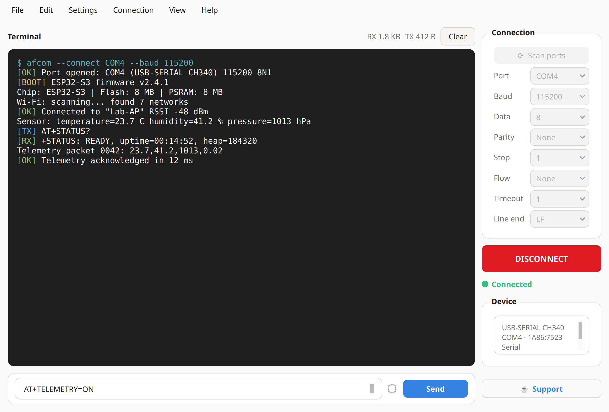
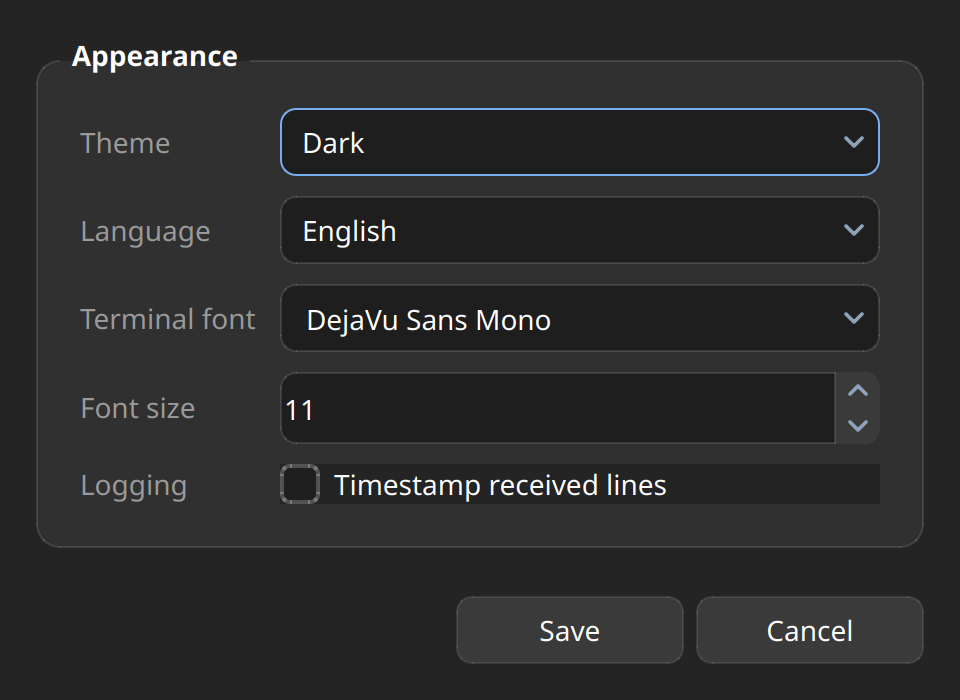
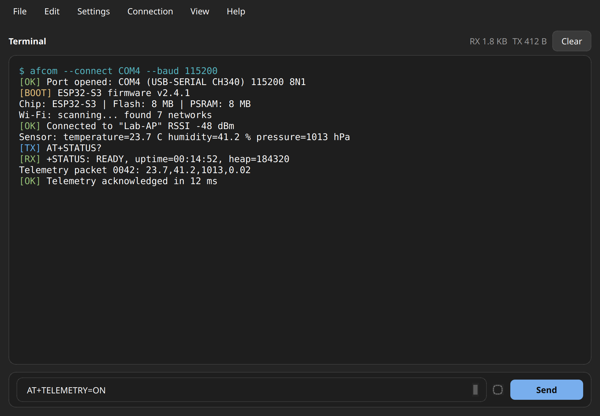
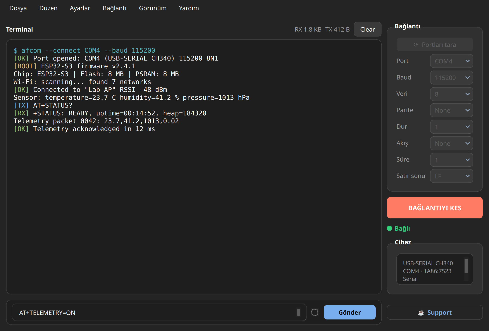

# AFCOM Client

<p align="center">
  
</p>

<h3 align="center">A fast, cross-platform serial (COM port) terminal for Windows, Linux and macOS.</h3>

<p align="center">
  <a href="https://github.com/mcagriaksoy/Serial-Communication-GUI-Program/releases/latest">
    
  </a>
  <a href="https://pypi.org/project/AFCOM/">
    
  </a>
  <a href="#license">
    
  </a>
  <a href="https://github.com/mcagriaksoy/Serial-Communication-GUI-Program/actions/workflows/release.yml">
    
  </a>
  <a href="https://github.com/mcagriaksoy/Serial-Communication-GUI-Program/issues">
    
  </a>
</p>

<p align="center">
  <a href="https://github.com/mcagriaksoy/Serial-Communication-GUI-Program/releases/latest">
    
  </a>
  <a href="https://pypi.org/project/AFCOM/">
    
  </a>
</p>


**AFCOM** is a desktop serial communication client for talking to
microcontrollers, sensors, modems, development boards and any other device that
exposes a serial interface. Scan ports, configure every common line setting,
watch incoming data with ANSI colours, and send commands — all from a clean
native Qt interface.

> Formerly known as **Serial Communication GUI Program**.

## Highlights

- **Cross-platform** — Windows, Linux and macOS; automatic COM/tty port discovery.
- **Complete serial configuration** — baud rate, data bits, parity, stop bits, flow control, timeout and line ending.
- **Real terminal** — scrollable output with ANSI colour support and optional timestamps.
- **Live statistics** — RX/TX byte counters and connected-device details.
- **Comfortable sending** — multi-line input, Enter to send, configurable CR/LF handling.
- **Save your logs** — write terminal output to a text file at any time.
- **Make it yours** — dark/light themes, English/Turkish UI, terminal font and size.
- **Distraction-free mode** — Basic View hides the configuration panel.
- **No telemetry, no account, no cloud** — everything runs locally.

## Screenshots

| Dark theme | Light theme |
| --- | --- |
|  |  |

| Preferences | Basic View |
| --- | --- |
|  |  |

<p align="center">
  
  <br>
  <em>English and Turkish interfaces are included.</em>
</p>

## Install

### Windows (recommended)

Download the latest build from
[**GitHub Releases**](https://github.com/mcagriaksoy/Serial-Communication-GUI-Program/releases/latest):

| File | Description |
| --- | --- |
| `AFCOM_Client_v1.9.1_win64_setup.exe` | Per-user installer — Start Menu shortcut, optional desktop shortcut, clean uninstall |
| `AFCOM_v1.9.1_portable_win64.exe` | Portable single-file executable — no installation required |

The installer does **not** require administrator rights. Windows 10 or newer is
recommended; Windows 11 is fully supported.

### PyPI (Windows, Linux and macOS)

```bash
pip install afcom
afcom
```

`AFCOM` is a pure-Python package. On Linux you may need the system Qt/Tk
libraries that ship with your distribution; PySide6 wheels bundle Qt itself.

### Run from source

Requirements: **Python 3.10+**, `pip`, and a virtual environment.

```bash
git clone https://github.com/mcagriaksoy/Serial-Communication-GUI-Program.git
cd Serial-Communication-GUI-Program

python3 -m venv .venv
source .venv/bin/activate          # Windows: .venv\Scripts\activate
python -m pip install --upgrade pip
pip install -r requirements.txt

python main.py
```

On Linux, if the application cannot create a window, install the usual Qt/X11
runtime packages for your distribution (for example `libxcb-cursor0` on recent
Debian/Ubuntu releases).

## Quick start

1. Connect your device and click **⟳ Scan ports**.
2. Select the port and match the serial settings to your device.
3. Click **CONNECT**. The status dot turns green when the port is open.
4. Type a command in the send box and press **Enter** (or click **Send**).
5. Incoming data appears in the terminal. Use **File → Save As…** to keep a log.

### Serial settings

| Setting | Options / notes |
| --- | --- |
| Baud rate | 110 … 921600 (115200 is selected by default) |
| Data bits | 5, 6, 7, 8 |
| Parity | None, Even, Odd, Mark, Space |
| Stop bits | 1, 1.5, 2 |
| Flow control | None, XON/XOFF, RTS/CTS, DSR/DTR |
| Timeout | 0.1 – 5 seconds |
| Line ending | None, LF, CR, CRLF (appended when sending) |

If you are unsure about your device's settings, start with **115200 8-N-1, no
flow control** — the most common configuration for development boards.

### Keyboard shortcuts

| Shortcut | Action |
| --- | --- |
| `Enter` in the send box | Send the current data |
| `Ctrl+Enter` | Send (from the Send button shortcut) |
| `Ctrl+A` | Select all terminal text |
| `Ctrl+C` | Copy selected terminal text |

## Using the terminal

- **ANSI colours** are rendered, so coloured firmware logs remain readable.
- **Timestamps** can be enabled in **Settings → Preferences** to prefix received lines.
- **Clear** empties the on-screen terminal; **Edit → Clear Buffers** also clears the send box.
- **Connection → Reset Terminal** clears both buffers and resets the RX/TX counters.
- **View → Basic View** hides the side panel for a wider terminal.
- **Help → Check for Updates** compares your version with the latest GitHub tag.
- Preferences are stored per user:
  - Windows: `%APPDATA%\AFCOM\settings.json`
  - macOS: `~/Library/Application Support/AFCOM/settings.json`
  - Linux: `~/.config/afcom/settings.json`

## Troubleshooting

**No ports are listed.** Reconnect the device, install its USB-serial driver
(CH340, CP210x, FTDI, etc.) and click **Scan ports** again. On Linux, make sure
your user is in the `dialout` group:

```bash
sudo usermod -aG dialout "$USER"
# log out and back in, then reconnect the device
```

**The port is busy.** Close any other terminal application using the device.
Only one program can own a serial port at a time.

**Garbled or missing output.** The baud rate, data bits, parity or stop bits do
not match the device. Check the device documentation and reconnect.

**Connection drops unexpectedly.** Some adapters are sensitive to flow control.
Try **Flow: None**, a longer timeout, or a different USB cable/port.

**`pip install afcom` installs an old version.** Upgrade explicitly:

```bash
python -m pip install --upgrade afcom
```

## Development

### Project structure

```text
main.py                 Application entry point
src/
  app.py                QApplication bootstrap
  main_window.py        Main window controller
  serial_worker.py      Background serial reader (QThread)
  serial_ports.py       Cross-platform port discovery
  settings_store.py     JSON preferences
  settings_dialog.py    Preferences dialog
  theme.py              Adwaita-inspired light/dark palettes
  translations.py       English / Turkish strings
  actions.py            Menu actions (save, about, help, updates)
  ansi.py               ANSI colour → HTML
  ui_loader.py          Loads / regenerates Qt Designer UI modules
  constants.py          Metadata, paths and defaults
ui/
  *.ui                  Qt Designer layouts (source of truth)
  theme.qss             Central stylesheet template
  build_ui.py           Regenerate the Python UI modules
test/                   pytest unit tests
installer/afcom.iss     Inno Setup installer script
scripts/build_windows.py PyInstaller release build helper
```

The `ui/*.ui` files are the single source of truth. Edit them in Qt Designer
(or manually) and regenerate the Python modules with:

```bash
python ui/build_ui.py
```

At startup the application also regenerates any `.ui` file that is newer than
its generated `.py` equivalent, so you normally do not need to run this by hand.

### Tests

```bash
pip install -r requirements.txt pytest
pytest test/
```

### Build a standalone executable

```bash
pip install -r requirements.txt pyinstaller
pyinstaller main.spec
```

For the versioned Windows release build:

```bash
python scripts/build_windows.py
# -> dist/AFCOM_v<version>_portable_win64.exe
```

On Windows, compile the installer with Inno Setup after the portable build:

```powershell
ISCC.exe /DVersion=1.9.1 `
  /DSourceExe=dist\AFCOM_v1.9.1_portable_win64.exe `
  /DOutputDir=release-artifacts installer\afcom.iss
```

## Releasing

Releases are driven by version tags. The single source of truth is
`APP_VERSION` in [`src/constants.py`](src/constants.py), and it must match the
tag without the leading `v`.

```bash
# 1. Bump APP_VERSION, commit and push master
git add -A
git commit -m "Release v1.9.1"
git push origin master

# 2. Tag the same commit and push the tag
git tag v1.9.1
git push origin v1.9.1
```

Pushing a `v*` tag runs two GitHub Actions workflows:

- **[`release.yml`](.github/workflows/release.yml)** — verifies the tag, builds
  the Windows portable executable with PyInstaller and the per-user installer
  with Inno Setup, then publishes both to a GitHub Release.
- **[`publish-pypi.yml`](.github/workflows/publish-pypi.yml)** — builds the
  sdist/wheel and publishes **AFCOM** to PyPI with Trusted Publishing (OIDC).
  If the version already exists on PyPI, publishing is skipped safely.

Every released executable receives a signed **build-provenance attestation**:

```bash
gh attestation verify AFCOM_v1.9.1_portable_win64.exe \
  --repo mcagriaksoy/Serial-Communication-GUI-Program
```

## Compatibility

| Platform | Installer / executable | PyPI package | Source |
| --- | --- | --- | --- |
| Windows 10/11 (x64) | ✅ portable + installer | ✅ | ✅ |
| Linux (x64) | — | ✅ `pip install afcom` | ✅ |
| macOS (Intel/Apple Silicon) | — | ✅ `pip install afcom` | ✅ |

Serial hardware support depends on the operating system drivers. Common USB
adapters (CH340, CP210x, FTDI, PL2303) work through their standard drivers.

## Contributing

Contributions, bug reports and feature requests are welcome.

- Report bugs via [GitHub Issues](https://github.com/mcagriaksoy/Serial-Communication-GUI-Program/issues)
- Open a pull request with a clear description and keep the existing code style
- Run `pytest test/` before submitting

## License

Released under the [GNU General Public License v3.0](LICENSE) by
[@mcagriaksoy](https://github.com/mcagriaksoy).

AFCOM uses Qt for Python (PySide6), licensed under LGPLv3.

## Support the project

<a href="https://www.buymeacoffee.com/mcagriaksoy">
  
</a>

---

<p align="center">Made for engineers, makers and anyone who still loves a good serial port.</p>
